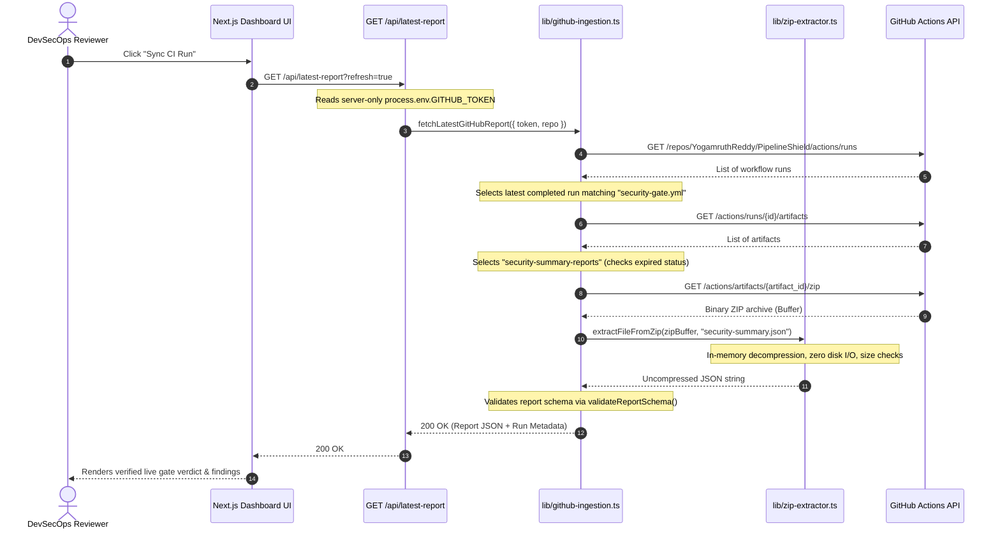

# PipelineShield Live GitHub Actions Report Ingestion 🔄

This document details the live report ingestion capability for the PipelineShield DevSecOps dashboard. It explains the system architecture, deterministic run selection, pure in-memory extraction, security boundaries, and local configuration.

---

## 1. Overview & Goal

PipelineShield can render security evaluations from three distinct data sources:
1. **Bundled Demonstration Datasets**: Pre-packaged synthetic scenarios (`Vulnerable PR`, `Clean Baseline`, `Advisory Warnings`, `Scanner Failure`) used for interactive UI review. Clearly badged as `Synthetic Demo` in amber.
2. **Uploaded Report JSON**: Static analysis files loaded manually from disk via the **Load Report** button. Badged as `Ingested Run (Uploaded file)`.
3. **Live GitHub CI Ingestion**: Automatic discovery, download, and extraction of the authoritative `security_summary_report.json` generated by remote GitHub Actions workflow runs via the **Sync CI Run** button. Badged as `Live CI Run #<id>` in emerald with a direct link to the GitHub Actions run.

---

## 2. Architecture & Data Flow



---

## 3. Strict Security Controls

Live ingestion adheres to the following hard security boundaries:

| Security Domain | Mitigation / Control |
| :--- | :--- |
| **Server-Side Token Isolation** | `GITHUB_TOKEN` is accessed exclusively in Node.js server routes (`process.env.GITHUB_TOKEN`). It is **never** prefixed with `NEXT_PUBLIC_*`, never bundled into browser client code, never included in HTTP response payloads or headers, and never written to disk or logs. |
| **Zero Disk I/O (Zip Slip Defense)** | Artifact ZIP archives are decompressed purely in memory using Node.js `Buffer` and `zlib.inflateRawSync`. No temporary files or directories are created on disk, completely eliminating path traversal and Zip Slip overwrite vulnerabilities. |
| **Archive Size & Memory Caps** | Max archive buffer size: **10 MB**. Max uncompressed file entry: **5 MB**. Any archive or decompressed stream exceeding these limits is immediately rejected with HTTP 413 (Payload Too Large), guarding against zip bombs and memory exhaustion. |
| **Deterministic Run Selection** | Queries are filtered strictly for completed runs belonging to `security-gate.yml` in the canonical repository (`YogamruthReddy/PipelineShield`). **No fallback** to unrelated workflows, arbitrary runs, or unverified samples is permitted. |
| **Contract Schema Enforcement** | Extracted JSON reports must strictly conform to PipelineShield's TypeScript contract schema via `validateReportSchema()`. Malformed or missing fields trigger HTTP 502 with structured error diagnostics. |
| **Graceful Fail-Safe Fallbacks** | If `GITHUB_TOKEN` is missing, rate-limited, or the network is offline, the dashboard displays a clear, dismissible warning banner. The manual file upload flow (**Load Report**) remains 100% available at all times. |

---

## 4. Environment Configuration

To enable live GitHub syncing locally or in deployment:

1. Create a `.env.local` file in `dashboard/` (or set environment variables on your hosting provider):
   ```bash
   # GitHub Personal Access Token (classic or fine-grained)
   GITHUB_TOKEN=ghp_yourPersonalAccessTokenHere

   # Target repository (defaults to YogamruthReddy/PipelineShield if omitted)
   GITHUB_REPOSITORY=YogamruthReddy/PipelineShield
   ```

2. **Required Token Permissions**:
   - **Fine-grained personal access token**:
     - Repository access: `Only select repositories` → `YogamruthReddy/PipelineShield`
     - Repository permissions:
       - **Actions**: Read-only
       - **Metadata**: Read-only
   - **Classic personal access token**:
     - `public_repo` (for public repositories) or `repo` (for private repositories)

> [!IMPORTANT]
> Never commit `.env.local` or any file containing real tokens. `.env.local` is listed in `.gitignore`.

---

## 5. Automated Verification & Testing

A comprehensive mock test suite covers all edge cases without requiring live GitHub credentials or network connectivity:

```bash
# Run the live ingestion and in-memory ZIP extractor test suite
npm run test:ingestion --prefix dashboard
```

The suite validates 28 test scenarios across 3 sections:
1. **Pure in-memory ZIP extractor**: Stored and deflated streams, directory nesting, missing entries, corrupted buffers, archive size caps, and zip bomb defense.
2. **GitHub API integration**: Missing token (401), invalid credentials (401), rate limits (429 with reset time), forbidden scopes (403), repository not found (404), upstream errors (502), timeouts (504), expired artifacts (410), oversized payloads (413), and cache-control headers.
3. **Security & workload isolation**: Token non-disclosure in payloads and error messages, strict rejection of unrelated workflows, and safe in-memory handling of entries with path traversal sequences (`../../`).

---

## 6. Known Boundaries & Scope

- **Read-Only Telemetry**: Live ingestion is strictly read-only. It queries completed runs and extracts published report artifacts; it does not trigger new GitHub Actions workflow dispatches from the browser.
- **Artifact Retention**: GitHub Actions retains artifact zip archives for 14 days by default. Runs older than the retention period return HTTP 410 (`Artifact expired`), prompting a new workflow run.
- **Repository Admin Controls**: Branch protection rules and production deployment triggers require repository admin permissions and remain managed through GitHub repository settings.

